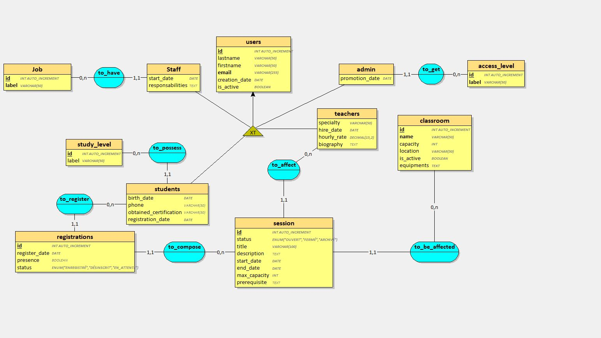
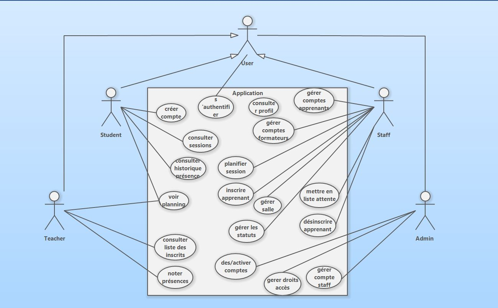

# brief_SQL

## Contributeurs
+ Mauro Fadika
+ Audric Gaillard
+ Jocelyne Minard


## Prérequis Techniques
#### Postgres

Pour qu'un utilisateur puisse accéder a la base Postgres :   

1. Connecter vous à Postgres : 
```sudo -u postgres psql  ```

2. Si l'utilisateur 'user_name' n'existe pas encore, créez-le avec un mot de passe :
```CREATE USER user_name WITH PASSWORD 'password';```  

3. S'il existe déjà mais n'a pas de mot de passe, définissez-en un :
```ALTER USER user_name WITH PASSWORD 'password';```  

4. Donnez-lui le droit de créer des bases de données (très utile pour votre script) :
```ALTER USER user_name CREATEDB;```  

5. Donnez-lui l'accès à la base de données 'postgres' par défaut :
```GRANT CONNECT ON DATABASE postgres TO user_name;```  

6. Verifier les modes de connection de postgres et modifier **peer** par **scram-sha-256**
```sudo vim pg_hba.conf```  

#### Python
Installer le fichier requirements.txt
``` pip install -r requierements.txt```


## Structure
#### Projet
```
brief_SQL/
│
├── .env                        # Env file , different on all user
├── _.env_example               # Example of .env file
├── main.py                     # Principal script(Lunch create database)
├── data.py                     # Data script (Add some value in all tables)
└── MCD/
    ├── Diagramme_Classes.JPG   # Picture of Classes diagram
    ├── looping_mcd.loo         # Binary file for looping Software
    ├── MCD.JPG                 # Picture of MCD diagram
└── models/
    ├── __init__.py             # Importe Base et tous les modèles
    ├── base.py                 # Contient la déclaration de Base
    ├── access_level.py         # Classe AccessLevel
    ├── admin.py                # Classe Admin
    ├── classroom.py            # Classe Classroom
    ├── job.py                  # Classe Job
    ├── registration.py         # Classe Registration
    ├── role.py                 # Classe Role
    ├── session.py              # Classe Session
    ├── staff.py                # Classe Staff
    ├── student.py              # Classe Student
    ├── study_level.py          # Classe StudyLevel
    ├── teacher.py              # Classe Teacher
    ├── user.py                 # Classe User
└── shemas/
    ├──                         # 
    ├──                         # 
    ├──                         # 
└── Readme.md
└── requierements.txt           # File for Python depedencies
```

#### MCD


#### Diagrame des cas d'utilisations



## Choix techniques

#### SQLAlchemy 
Nous avons decider de partir sur SQLAlchemy car celui-ci reste un standard et est très bien documenté.
De plus cela nous à paru plus simple pour séparer les modèles et les schémas de Pydantic.
Dans les différentes documentations que nous avons pu lire il se trouve également qu'il y a moins de bug que sur SQLModel.

#### Postgres
Nous sommes parti sur Postgres car nous voulions implémenter un vrai SGBD et le manipuler, puisque nous avons déjà vu SQLite pour Python auparavant.  
Postgres s'est imposé face à MariaDb puisque pour certains nous avons rencontré des soucis d'installation avec Mariadb, ou ensuite une difficulté à implémenter les connections en Python malgrès le cours sur le sujet.

#### Alembic
Alembic est l'outil de migration associé à SQLAlchemy. Il versionne le schéma de la base : chaque évolution est décrite dans un fichier de migration, appliquée dans l'ordre, et peut être annulée. Cela permet de faire évoluer la base sans la recréer et sans perdre les données existantes.

##### Migrations du projet
001: Création des tables
002: Modification du champs `equipments`de la table `Classroom` de str à json.

La table Session contient déjà un champs `statut` et le role `SUPERADMIN` est une valeur entrée dans la table `access_level`.

#### Looping
Mauro ayant de l'experience avec ce logiciel, c'est tout naturellement que nous l'avons utiliser pour réaliser le MCD

#### Mermaid
Logiciel vu en formation, nous avons utiliser le live editor qui reste gratuit car nous n'avions pas besoin de fonctionnalitées poussées. 

